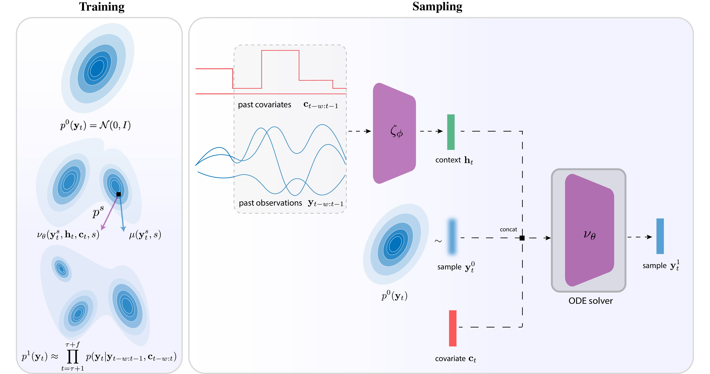
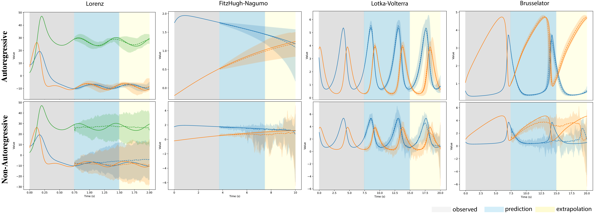

# AFM: Autoregressive Flow Matching for Probabilistic Time Series Forecasting

AFM is a JAX library for probabilistic multivariate time series forecasting. Given historical observations and optional future covariates, AFM models the joint distribution of future trajectories by decomposing it into a sequence of conditional densities, each learned via a shared flow matching transformation. This combines the strengths of autoregressive models (strong extrapolation, compact size, calibrated uncertainty) with the ability of transport-based generative models to capture complex, multi-modal distributions.

[[Paper]](https://arxiv.org/abs/2503.10375)

<p align="center">
  
</p>

<p align="center">
  
</p>

## Installation

```bash
pip install -e .
```

## Quick Start

```python
import jax.random as jrandom
import flax.nnx as nnx

from afm import AutoregressiveFlowMatching, Config, create_system
from afm.training.data import prepare_trajectories, create_infinite_dataloaders
from afm.training.trainers import AFMTrainer

# 1. Generate training data from a dynamical system
system = create_system("lorenz", stochastic=True)
config = Config(system_name="lorenz", system_stochastic=True)
train_traj, test_traj, ts = prepare_trajectories(system, config, jrandom.PRNGKey(0))
(train_loader, test_loader), _ = create_infinite_dataloaders(train_traj, test_traj, ts, config)

# 2. Build and train
model = AutoregressiveFlowMatching(
    dim_x=system.data_dim, dim_c=config.model_covariates_dim,
    dim_h=config.model_hidden_dim, dim_t=config.model_time_dim,
    dim_hidden=config.model_hidden_dim, hidden_blocks=config.model_hidden_blocks,
    n_rnn_layers=config.model_n_rnn_layers, rnn_hidden=config.model_rnn_hidden,
    rngs=nnx.Rngs(0),
)
trainer = AFMTrainer(model, learning_rate=config.training_learning_rate)
trainer.train(train_loader, test_loader, num_epochs=50, use_wandb=False)

# 3. Probabilistic forecast
samples = model.sample(
    jrandom.PRNGKey(42),
    test_traj[0, :config.context_length][None],   # history  (1, ctx, dim)
    ts[:config.context_length, None][None],        # covariates (1, ctx, 1)
    nfe=20, n_steps_pred=30, n_samples=50,
)  # → (50, 1, 30, dim)
```

## Available Systems

| System | Dimensions | Description |
|--------|-----------|-------------|
| `lorenz` | 3 | Chaotic attractor |
| `lotka_volterra` | 2 | Predator-prey dynamics |
| `vanderpol` | 2 | Nonlinear oscillator |
| `harmonic_oscillator` | 2 | Linear oscillator |
| `fitzhugh_nagumo` | 2 | Neuronal dynamics |
| `brusselator` | 2 | Chemical oscillator |
| `duffing` | 2 | Forced nonlinear oscillator |

All systems support both deterministic and stochastic (SDE) modes via `create_system(name, stochastic=True/False)`.

## CLI for Paper Experiments

The package includes a CLI for reproducing the experiments from the paper:

```bash
afm list                           # list available experiments
afm run afm_vs_fm_single           # run bundled experiment config
afm run path/to/config.yaml        # run custom config
afm validate afm_vs_fm_single      # check config validity
```

See `docs/experiments.md` for details on the experiment system.

## Citation

```bibtex
@article{el2025probabilistic,
  title={Probabilistic Forecasting via Autoregressive Flow Matching},
  author={El-Gazzar, Ahmed and van Gerven, Marcel},
  journal={arXiv preprint arXiv:2503.10375},
  year={2025}
}
```
